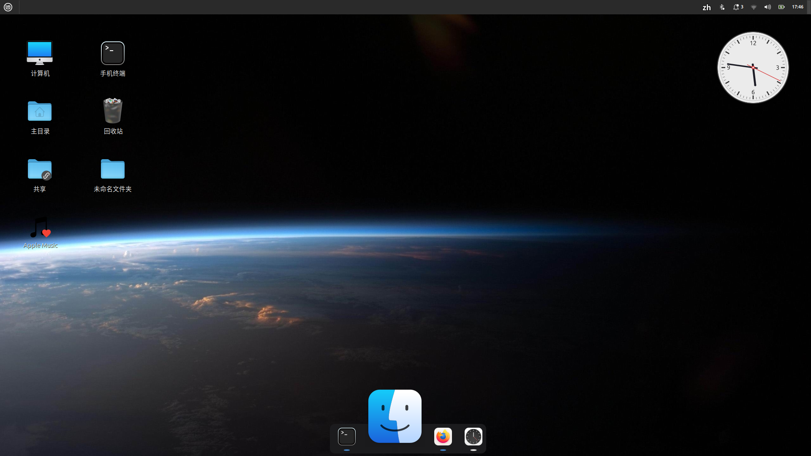

# TinyDock

[](https://github.com/Wian1977/TinyDock/actions) [](LICENSE) [](https://github.com/Wian1977/TinyDock/releases)

> **A Super Easy Dock** —— 轻量、弹性、开箱即用，一行命令装好就能用。



一个用 **Rust + GTK3** 实现的轻量级底部 dock，主打「悬停弹性放大」与简洁的窗口指示。

## 特性

- **悬停弹性放大**：鼠标移入图标时平滑放大（默认最高 3×），移出回弹；放大时横向溢出覆盖相邻图标，营造弹性观感。
- **窗口指示圆点**：每个图标下方的小圆点表示其窗口状态
  - 白色圆点 + 淡淡光晕：**当前聚焦窗口**
  - 蓝色圆点：**有窗口但非聚焦**
  - 无圆点：未运行
  - 圆点可切换为「线」状（压扁的横向椭圆）
- **右键菜单**（在 dock 空白处或图标间隙点击）：
  - **底部栏透明**：透明 / 不透明 二选一
  - **指示形状**：圆点 / 线
  - **悬停放大**：1× / 2× / 3× 三档
  - **添加应用…**：从 /usr/share/applications 选择桌面项固定到 dock
  - **退出**
- **图标间隙右键热区**：图标之间有透明、无颜色的右键热区，便于点到空白处唤出菜单，且不额外撑开间距。
- 配置自动持久化到 ~/.config/tinydock/，重启后保留。

## 系统要求 / 兼容性

- Linux 桌面环境（GNOME / Cinnamon 等 GTK3 桌面）。
- **预构建安装包（推荐直接下载）**，按发行版选择对应包：

  | 发行版 | 安装包 |
  |--------|--------|
  | Ubuntu 24.04 / **Linux Mint 22** | `tinydock_1.0_amd64.deb` |
  | Ubuntu 22.04 / **Linux Mint 21** | `tinydock_1.0_amd64_ubuntu22.deb` |

  > 两者仅运行库包名不同（24.04 为 t64 改名后的 `libgtk-3-0t64`，22.04 为 `libgtk-3-0`），源码完全一致，已用 CI 在两个 runner 上分别自动构建并随 Release 发布。
- 运行期依赖（打包时由 dpkg-shlibdeps 自动推导）：GTK3、libwnck-3、cairo、glib、pango、atk 等。
- 构建依赖：cargo + rustc、libgtk-3-dev、libwnck-3-dev、pkg-config。
- **tclock 额外构建依赖**（eframe/OpenGL）：libxkbcommon-dev、libwayland-dev、libx11-dev、libgl1-mesa-dev、libglu1-mesa-dev、libasound2-dev、pkg-config。
- **架构**：默认 amd64（x86_64）。其他架构（如 aarch64）需在本机重新构建，源码无需改动。
- **包格式**：仅提供 .deb（本环境无 rpmbuild）。RPM 系可手动用 install.sh 安装，或自行制作 spec。

> 关于 Ubuntu 24.04 的 t64 改名：libgtk-3-0 / libglib2.0-0 在该版本改为 …t64。
> 打包脚本不写死包名，而是用 dpkg-shlibdeps 实时推导，因此生成的 .deb 依赖总是正确匹配。

## 从源码构建

```bash
# 安装构建依赖（Debian / Ubuntu / Mint）
sudo apt install -y cargo rustc libgtk-3-dev libwnck-3-dev pkg-config

# 构建 release 版本
cargo build --release
# 产物：target/release/tinydock
```

## 安装

### 方式一：下载预构建 .deb（推荐，可用系统包管理器管理）

到 [Releases](https://github.com/Wian1977/TinyDock/releases) 下载对应发行版的包，然后：

```bash
# Ubuntu 24.04 / Linux Mint 22：
sudo dpkg -i tinydock_1.0_amd64.deb
# Ubuntu 22.04 / Linux Mint 21：
sudo dpkg -i tinydock_1.0_amd64_ubuntu22.deb
# 若提示依赖缺失，自动补全：
sudo apt -f install
```

也可以本地自行打包（产出同名的 .deb）：

```bash
make deb                        # 默认产出当前系统对应版本的 tinydock_1.0_amd64.deb
make deb DEB_SUFFIX=_ubuntu22   # 产出 ubuntu22 版本（须在 22.04 系构建）
```

### 方式二：直接安装到 /usr/local（免打包）

```bash
make install        # 等价于 sudo ./install.sh
```

两种方式都会：
- 写入 tinydock.desktop 与 tclock.desktop 到系统应用菜单（/usr/share/applications）；
- 写入自启项让 **TinyDock 与 tclock 都随登录自动启动**（方式二写入 ~/.config/autostart/，方式一 .deb 写入 /etc/xdg/autostart/）。

## 运行

安装后直接执行 tinydock，或在应用菜单搜索 TinyDock。
也可从终端前台运行以查看日志：tinydock。

## 配置文件

所有状态保存在 ~/.config/tinydock/：

| 文件 | 内容 | 说明 |
|------|------|------|
| launchers.txt | 固定的应用 desktop ID 列表 | 每行一个，如 firefox.desktop |
| hover_scale | 悬停放大倍数 | 1 / 2 / 3 |
| bar_transparent | 底部栏是否透明 | 1 透明 / 0 不透明 |
| dot_shape | 指示形状 | 0 圆点 / 1 线 |

这些都可通过右键菜单直接修改，一般无需手动编辑。

## 卸载

```bash
# 若用 .deb 安装
sudo dpkg -r tinydock

# 若用 make install / install.sh 安装
make uninstall
```

## 随包附带的 tclock

本包同时打包了 **tclock**（一个用 Rust + eframe 实现的桌面模拟时钟小组件），
它与 TinyDock 一起随登录自动启动。

- tclock 通过 dlopen 动态加载 OpenGL / XKB / X11，打包脚本已显式补充
  `libgl1`、`libxkbcommon0`、`libx11-6` 等运行期依赖（桌面环境一般已自带）。
- 如需关闭 tclock 自启：删除对应的自启项
  （`~/.config/autostart/tclock.desktop`，或 .deb 方式下的 `/etc/xdg/autostart/tclock.desktop`）。
- tclock 源码已随仓库一并附带在 `tclock/` 子目录，构建/打包脚本默认使用该目录；
  如需指向其他位置的 tclock 源码，可用环境变量 `TCLOCK_SRC` 覆盖。

## 已知限制

- 仅支持 GTK3 桌面；窗口状态依赖 libwnck-3（每 500ms 轮询一次）。
- 当前仅在 x86_64 上构建验证过。
- 应用固定通过 desktop 文件 ID 记录，桌面项被删除后对应图标会失效。
